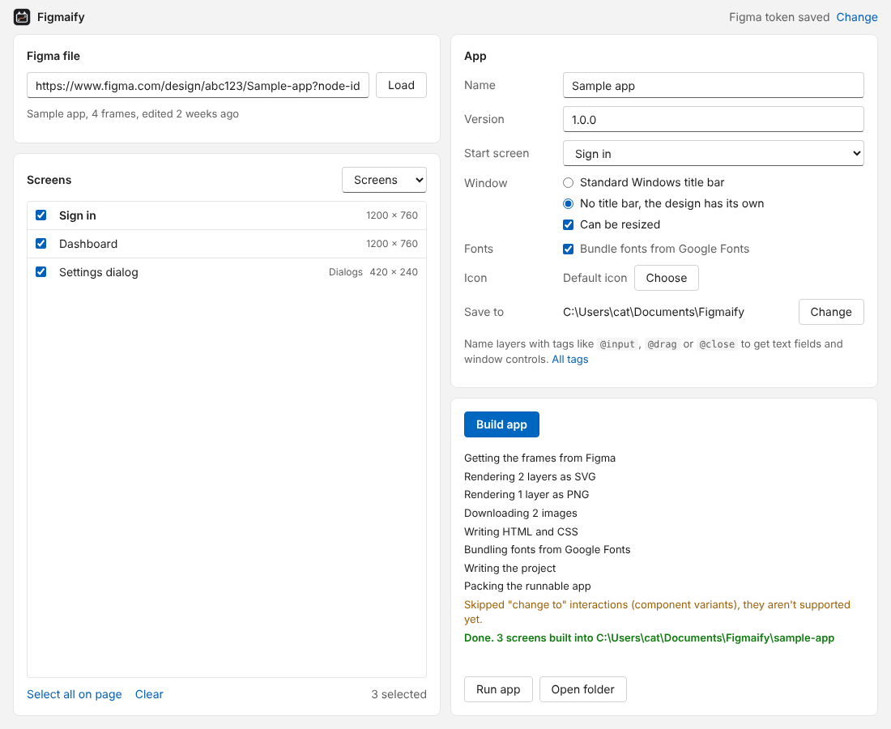

# Figmaify

Turn a Figma design into a Windows desktop app.

Paste a link to a Figma file, pick the frames you want as screens, and Figmaify builds an Electron app out of them. You get a folder with an .exe you can run straight away, plus the source project if you want to keep going in code.



Windows comes first. Linux is planned.

## Download

Get the installer or the zip from [Releases](https://github.com/Cat-things/figmaify/releases).

The builds aren't code signed yet, so SmartScreen will complain the first time. Click "More info" and then "Run anyway".

## Using it

1. In Figma, go to Settings, Security, Personal access tokens and make a token with the `file_content:read` scope. Paste it into Figmaify. It's encrypted with Windows (DPAPI) and only ever sent to Figma.
2. Paste the link to your design file and hit Load.
3. Tick the frames that should become screens and pick the start screen. Everything on the page is ticked by default. If a prototype link points at a frame you left out, it gets pulled in anyway.
4. Name the app, pick the window style and an icon if you have one, then hit Build app.

You end up with this:

```
Documents/Figmaify/my-app/
  app/       ready to run, open "My App.exe"
  source/    the Electron project behind it
```

The `app` folder runs on any Windows 10 or 11 machine, no Node or npm needed. Zip it up and send it to whoever. It's around 250 MB because it carries its own copy of Chromium, same as every Electron app.

If the app from the last build is still open, close it before building again. Windows won't let its files be replaced while it runs.

To work on the code, open `source` and run `npm install`, then `npm start`. `npm run dist` makes an installer.

## What carries over

| In Figma | In the app |
| --- | --- |
| Top level frames | Screens. The window opens at the start frame's size |
| Auto layout | Flexbox with fill, hug, fixed, wrap, gaps, padding and alignment |
| Constraints | Kept, so resizing the window behaves like resizing the frame |
| Solid, gradient and image fills | CSS backgrounds |
| Strokes, corner radius, shadows, blurs, blend modes | CSS |
| Text | Real text: font, size, weight, line height, letter spacing, case, decoration, lists, truncation, mixed styles and links |
| Vectors, icons, boolean shapes, rotated layers | SVG rendered by Figma |
| Masked groups | One image rendered by Figma |
| Scrolling frames | Scroll |
| Prototype actions | Navigate, back, open overlay, swap overlay, close overlay, scroll to and open link |
| Prototype triggers | On click, on press, after delay and key press |
| Transitions | Dissolve and smart animate fade in, move in, slide in and push slide in, the rest are instant |
| Overlay settings | Position, background color and close on click outside |

## Layer tags

Put these anywhere in a layer name, like `Search box @input`.

| Tag | What it does |
| --- | --- |
| `@input` | The frame becomes a text field. The first text layer inside is used as the placeholder |
| `@password` | Same, with the characters hidden |
| `@textarea` | A multi line text field |
| `@drag` | You can drag the window by this layer. Meant for windows without a title bar |
| `@close` `@minimize` `@maximize` | Window buttons |
| `@image` | Render this layer as one image instead of converting it |

`@input` and `@password` also work on a text layer directly.

If you pick "No title bar", draw your own title bar in the design and tag it `@drag`, with a `@close` button in it. Figmaify warns you when either one is missing.

## Not supported yet

- Hover, while pressing, drag and mouse enter triggers
- Component variant changes ("change to"), variables and conditional actions
- Video fills
- Grid auto layout. Those frames keep their children where they are instead
- FigJam boards and Slides decks
- Fonts that aren't on Google Fonts don't get bundled. The app uses them if they're installed, otherwise it falls back to Segoe UI

## Figma API limits

Figma limits how often its API can be called, and View and Collab seats get very few calls a month. A build usually takes one call to load the file, one to fetch the frames, one or two to render vectors, and one for image fills. Frames and renders are cached per file version, so building again with different settings doesn't touch the API unless the file changed.

A Dev or Full seat makes life a lot easier here.

## Building from source

You need Node.js 22 and Windows.

```
npm install
npm start           # run Figmaify
npm run dev         # same, with F12 for devtools and F5 to reload
npm test
npm run typecheck
npm run dist        # installer and zip end up in dist/
```

`npm run icons` redraws the icons after you edit `build/icon.svg` or `src/template/icon.svg`.

## How it works

- `src/core` talks to the Figma API and does the conversion. None of it needs Electron, which is why the tests run on plain Node.
- `src/core/convert` turns Figma nodes into HTML and CSS. Anything CSS can't do well (vectors, masks, rotation) gets rendered by Figma instead.
- `src/template` holds the files every generated app starts from: the Electron main process, the preload and the small script that switches screens.
- `src/main` and `src/renderer` are Figmaify's own window.

For the runnable copy, Figmaify copies the Electron runtime it's running on, renames the exe, drops the generated app into `resources/app` and sets the icon and version info with rcedit.

## License

MIT, see [LICENSE](LICENSE).

Figmaify isn't made by or affiliated with Figma. Figma is a trademark of Figma, Inc.
